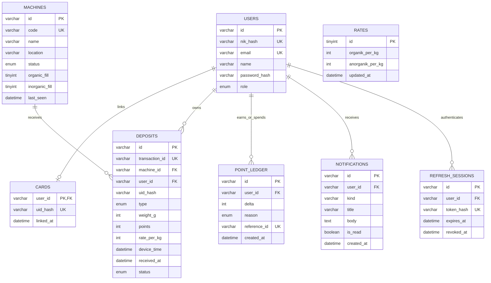

# SmartBIN — Aplikasi Flutter dan Backend

Aplikasi publik untuk membuat akun dengan NIK dan email, melihat saldo poin/riwayat setoran, menautkan KTP ke akun, dan memantau mesin SmartBIN. Admin bisa memantau mesin dan mengatur nilai poin.

Dokumen ini adalah **acuan kerja tim**. Baca sampai habis sebelum mulai coding, dan ikuti aturannya supaya kode kita tetap seragam dan tidak saling menimpa.

> Status saat ini: Flutter memakai API publik sebagai default (`https://api-smartbin.ramadhanjp.my.id/api/v1`). URL bisa diganti ke backend lokal lewat `--dart-define`; mock tetap tersedia untuk demo. NFC asli, telemetri, dan push FCM masih perlu integrasi tersendiri. Lihat [Status pekerjaan](#status-pekerjaan).

---

## Daftar isi

1. [Sumber acuan](#sumber-acuan)
2. [Menyiapkan lingkungan](#menyiapkan-lingkungan)
3. [Menjalankan aplikasi](#menjalankan-aplikasi)
4. [Akun demo](#akun-demo)
5. [Struktur proyek](#struktur-proyek)
6. [Arsitektur dan aliran data](#arsitektur-dan-aliran-data)
7. [Aturan penulisan kode](#aturan-penulisan-kode)
8. [Panduan UI](#panduan-ui)
9. [Cara menambah fitur](#cara-menambah-fitur)
10. [Pengujian](#pengujian)
11. [Alur kerja tim](#alur-kerja-tim)
12. [Status pekerjaan](#status-pekerjaan)
13. [Backend NestJS + MySQL](#backend-nestjs--mysql)
14. [Masalah umum](#masalah-umum)

---

## Sumber acuan

Kalau ada perbedaan, urutan prioritasnya adalah sebagai berikut:

1. **PRD** — [design/stitch/04_PRD_SmartBIN_Aplikasi_Mobile_Flutter_md_code.md](design/stitch/04_PRD_SmartBIN_Aplikasi_Mobile_Flutter_md_code.md). Isinya kebutuhan fungsional (ID `FR-…`), daftar layar (`S01`–`S16`), endpoint API, dan aturan format.
2. **Desain Google Stitch** — [design/stitch/](design/stitch/). Tiap layar punya screenshot (`.png`/`.jpg`) dan HTML Tailwind aslinya (`_code.html`). Pakai HTML-nya untuk melihat warna, ukuran, dan teks yang persis.
3. **README ini** untuk aturan teknis dan konvensi kode.

Kalau desain Stitch bertentangan dengan PRD, ikuti **PRD**. Contohnya, tab ke-4 navigasi bawah adalah **Profil** sesuai PRD.

Pemetaan layar ke file kode:

| PRD | Layar | Desain Stitch | File |
| --- | --- | --- | --- |
| S01 | Onboarding | – (dari PRD) | `features/onboarding/onboarding_screen.dart` |
| S02 | Login | `09_Masuk_Akun` | `features/auth/login_screen.dart` |
| S03 | Registrasi | `10_Registrasi_Mahasiswa` | `features/auth/register_screen.dart` |
| S04 | Tautkan KTP | `01_Tautkan_KTM` | `features/card/link_ktp_screen.dart` |
| S05 | Beranda | `08_Beranda`, `11_Memuat_Data` | `features/home/home_screen.dart` |
| S06 | Riwayat | `05_Riwayat_Setoran` | `features/history/history_screen.dart` |
| S07 | Detail setoran | `02_Detail_Transaksi_Setoran` | `features/history/deposit_detail_screen.dart` |
| S08 | Daftar mesin | `06_Status_Mesin` | `features/machines/machines_screen.dart` |
| S10 | Notifikasi | `07_Notifikasi` | `features/notifications/notifications_screen.dart` |
| S11 | Profil | `12_Profil_Pengguna` | `features/profile/profile_screen.dart` |
| S12 | Nilai poin & panduan | – (dari PRD) | `features/profile/rates_guide_screen.dart` |
| S16 | Admin | `13_Admin_Dashboard_Status_Mesin` | `features/admin/admin_dashboard_screen.dart` |

---

## Menyiapkan lingkungan

| Kebutuhan | Versi yang dipakai |
| --- | --- |
| Flutter | **3.47.6** (channel stable) |
| Dart | 3.13.5 |
| Android | minimal Android 8.0 (API 26) |
| JDK | JDK bawaan Android Studio (`Android Studio\jbr`) |

Semua anggota tim **harus memakai versi Flutter yang sama** supaya `pubspec.lock` tidak berubah-ubah. Cek dengan `flutter --version`.

### Wajib: letakkan Flutter SDK di path tanpa spasi

Flutter versi ini gagal build kalau **path SDK-nya mengandung spasi**, misalnya `D:\Polijesip\APK MOBILE\flutter`. Error yang muncul:

```
'D:\Polijesip\APK' is not recognized as an internal or external command
Building native assets for package:objective_c failed.
```

Solusi permanen: pindahkan folder SDK ke path tanpa spasi, misalnya `C:\flutter`, lalu perbarui entri Flutter di PATH Windows.

Kalau belum sempat memindahkan SDK, pakai drive virtual sementara:

```powershell
subst S: "D:\Polijesip\APK MOBILE"
cd S:\smartbin
S:\flutter-develop\flutter\bin\flutter.bat run
# setelah selesai:
subst S: /D
```

Dengan cara ini, selalu panggil `flutter.bat` lewat path lengkap `S:\...`. Perintah `flutter` biasa tetap mengarah ke SDK di path yang ada spasinya.

### JAVA_HOME

Kalau muncul `JAVA_HOME is not set`, arahkan ke JDK bawaan Android Studio:

```powershell
$env:JAVA_HOME = 'D:\Polijesip\Android Studio\jbr'   # sesuaikan dengan lokasi di laptopmu
```

Atau jalankan `flutter config --jdk-dir="<path ke jbr>"` sekali saja.

### Langkah pertama setelah clone

```powershell
flutter pub get
flutter analyze      # harus "No issues found!"
flutter test         # semua harus lulus
```

---

## Menjalankan aplikasi

| Target | Perintah | Catatan |
| --- | --- | --- |
| HP Android | `flutter run` | Memakai API publik default. Aktifkan USB debugging di HP. |
| Chrome | `flutter run -d chrome` | Memakai API publik default. Tekan F12 → ikon HP untuk ukuran ponsel. |

Pilih API lokal dengan `--dart-define=API_BASE_URL=...`, atau jalankan mode mock dengan `--dart-define=SMARTBIN_USE_MOCK=true`. Panduan alamat lokal ada di [Menyambungkan aplikasi ke API](#menyambungkan-aplikasi-ke-api).

Saat aplikasi berjalan: tekan `r` untuk hot reload, `R` untuk hot restart, dan `q` untuk keluar.

Fitur yang memakai hardware (NFC) hanya disimulasikan, jadi semua alur bisa dicoba di Chrome.

---

## Akun demo

Mode mock memakai data dari [lib/data/mock_smartbin_repository.dart](lib/data/mock_smartbin_repository.dart) dan kembali ke awal setiap kali aplikasi di-restart. Aktifkan dengan `--dart-define=SMARTBIN_USE_MOCK=true`. Mode default memakai API publik sehingga akun demo mock di tabel ini tidak berlaku di server.

| Peran | Login | Kata sandi | Kondisi awal |
| --- | --- | --- | --- |
| Pengguna demo | NIK `1234567890123456` atau email `ramadhan@example.com` | `smartbin123` | KTP belum tertaut, saldo 1.450, ada 120 poin tertahan dari 2 setoran |
| Admin | `admin@smartbin.id` (pilih tab **Admin / Teknisi**) | `admin1234` | 4 mesin: Siap, Penuh, Gangguan, Offline |

Skenario yang bisa dicoba:

- **Gagal login:** sandi salah 5 kali akan mengunci login selama 5 menit.
- **Tautkan KTP:** dari banner Beranda pilih Tautkan Sekarang, lalu Mulai Pindai NFC. Pembacaan di aplikasi masih disimulasikan; mode mock mengkreditkan 120 poin tertahan.
- **Registrasi baru:** daftar dengan NIK 16 digit, nama, email umum, dan kata sandi. Setelah daftar, aplikasi membuka layar tautkan KTP.
- **Admin:** pilih Unit #04 yang berstatus Gangguan untuk mencoba tombol reset.

---

## Struktur proyek

```
lib/
├── main.dart                     # entry point: ProviderScope, tema, router, locale id_ID
├── core/                         # dipakai lintas fitur, tidak berisi logika bisnis
│   ├── format/formatters.dart    # Fmt: format poin, kg, waktu WIB — WAJIB dipakai
│   ├── router/
│   │   ├── app_router.dart       # semua rute + aturan redirect (login, onboarding, admin)
│   │   └── main_shell.dart       # bottom navigation 4 tab
│   ├── theme/app_theme.dart      # warna (AppPalette), font, tema terang & gelap
│   └── widgets/common.dart       # komponen UI bersama (kartu, pill, skeleton, error, dll.)
├── data/                         # lapisan data
│   ├── models.dart               # model: AppUser, Deposit, Machine, Rates, dll.
│   ├── smartbin_repository.dart  # INTERFACE (kontrak) ke backend
│   ├── mock_smartbin_repository.dart  # implementasi mock (data palsu)
│   └── nfc_reader.dart           # interface + mock pembaca NFC
├── state/providers.dart          # semua provider Riverpod (auth, data, preferensi)
└── features/<fitur>/             # satu folder per fitur, berisi layar & widget khususnya
    ├── auth/  card/  home/  history/  machines/
    └── notifications/  onboarding/  profile/  admin/

design/stitch/                    # desain Stitch + PRD (referensi, jangan diubah)
test/
├── widget_test.dart              # unit test formatter
├── app_flow_test.dart            # test alur utama + screenshot
└── goldens/                      # screenshot hasil test (acuan visual)
```

---

## Arsitektur dan aliran data

```
Layar (features/)  →  Provider (state/)  →  Repository (data/)  →  Backend REST / Mock
     ConsumerWidget      Riverpod             interface              /api/v1
```

Aturan yang **tidak boleh dilanggar**:

1. **Layar tidak boleh memanggil HTTP atau API langsung.** Layar hanya membaca provider, dan provider memanggil `SmartbinRepository`.
2. **Aplikasi tidak menghitung poin sendiri** (NFR-04). Semua angka poin berasal dari API. Rumus di layar Detail Setoran hanya menampilkan data dari server.
3. **NIK dan UID kartu tidak boleh disimpan mentah atau di-log.** Backend menyimpan HMAC NIK/UID dengan secret berbeda; UID dari NFC hanya diteruskan sekali ke `repository.linkCard(uid)`.
4. **Tidak ada rahasia di dalam aplikasi**: tidak ada API key broker MQTT dan tidak ada secret HMAC.
5. **Aplikasi tidak bicara ke MQTT atau mesin.** Semua lewat backend REST.

### Teknologi

| Kebutuhan | Paket |
| --- | --- |
| State management | `flutter_riverpod` 3.x |
| Navigasi | `go_router` 18.x |
| Format tanggal/angka | `intl` (locale `id_ID`) |
| Font | `google_fonts` (Plus Jakarta Sans) |
| Preferensi lokal | `shared_preferences` (tema, onboarding, notifikasi) |

Tambahkan paket baru hanya setelah **disepakati tim**, dan cek dulu kompatibilitasnya dengan Flutter 3.47.

> **google_fonts 9.x:** jangan pakai `GoogleFonts.xxxTextTheme(...)` karena tipenya bentrok dengan `TextTheme` Flutter. Pakai `GoogleFonts.plusJakartaSans(...)` (TextStyle) seperti di `app_theme.dart`.

### Provider yang tersedia (`state/providers.dart`)

| Provider | Isi |
| --- | --- |
| `authProvider` | sesi login: `login`, `register`, `logout`, `linkCard`, `unlinkCard`, `updateName` |
| `currentUserProvider` | user yang sedang login (`AppUser?`) |
| `pointsSummaryProvider` | saldo, poin tertahan, ringkasan bulan ini |
| `depositsProvider(type)` | riwayat setoran (`null` = semua jenis) |
| `depositDetailProvider(id)` | detail satu setoran |
| `ratesProvider` | nilai poin per kg (fallback ke nilai tersimpan kalau gagal) |
| `machinesProvider`, `telemetryProvider(id)` | status mesin dan log telemetri |
| `notificationsProvider`, `unreadCountProvider` | notifikasi dan jumlah yang belum dibaca |
| `themeModeProvider`, `onboardingSeenProvider`, `notificationSoundProvider` | preferensi perangkat |

Setelah aksi tulis (misalnya tautkan KTP), muat ulang data dengan `ref.invalidate(xxxProvider)`.

---

## Aturan penulisan kode

### Umum

- Kode harus lolos `flutter analyze` **tanpa warning** sebelum di-push.
- Format dengan `dart format lib test`. Lebar baris **150** sudah diatur di `analysis_options.yaml`, jadi hasilnya sama di semua laptop.
- Nama class, variabel, dan fungsi dalam **bahasa Inggris** (`DepositTile`, `heldPoints`).
- **Semua teks yang tampil ke pengguna dalam bahasa Indonesia** (`'Tautkan Sekarang'`).
- Komentar boleh dalam bahasa Indonesia. Tulis seperlunya, untuk menjelaskan *kenapa*, bukan *apa*.
- Sertakan ID PRD di komentar kalau kode memenuhi aturan khusus, contoh: `// FR-AUTH-04: cache dibersihkan saat logout`.

### Format data — WAJIB lewat `Fmt`

Jangan memformat angka atau tanggal sendiri. Selalu pakai [lib/core/format/formatters.dart](lib/core/format/formatters.dart):

| Data | Fungsi | Hasil |
| --- | --- | --- |
| Poin | `Fmt.points(1450)` | `1.450` |
| Poin bertanda | `Fmt.signedPoints(120)` | `+120` |
| Berat (API dalam gram) | `Fmt.kg(1200)` | `1,20` |
| Jam | `Fmt.time(t)` | `10:15 WIB` |
| Tanggal | `Fmt.date(t)` / `Fmt.dateTime(t)` | `24 Okt 2026` / `24 Okt 2026, 10:15 WIB` |
| Judul grup hari | `Fmt.dayHeader(t, now)` | `Hari Ini, 24 Okt 2026` |

Waktu dari API berformat UTC dan `Fmt` yang mengonversinya ke WIB. Waktu setoran yang ditampilkan adalah `deviceTime` (jam RTC mesin), **bukan** `receivedAt`.

### Penamaan file

- `snake_case.dart`. Layar diakhiri `_screen.dart`, contoh `history_screen.dart`.
- Widget yang hanya dipakai di satu layar ditulis sebagai class privat (`_NamaWidget`) di file layar itu.
- Widget yang dipakai di dua fitur atau lebih dipindah ke `core/widgets/common.dart`.

### Penanganan error

- Lempar `AppException('pesan untuk pengguna')` dari repository. Pakai `field:` untuk error per kolom form.
- Di layar, tampilkan pesannya dengan `errorText(e)` atau `ErrorView`. **Jangan pernah menampilkan pesan teknis mentah** (stack trace, kode HTTP).

---

## Panduan UI

Semua nilai berasal dari desain Stitch dan sudah tersedia di tema. **Jangan menulis kode warna hex langsung di layar.**

### Warna

Ambil warna lewat `context.palette`. Warna ini otomatis menyesuaikan mode gelap.

| Token | Terang | Dipakai untuk |
| --- | --- | --- |
| `brand` | `#1B5E20` | tombol utama, aksen |
| `textPrimary` | `#1B5E20` | judul, angka penting |
| `textSecondary` | `#2E4732` | teks isi |
| `textMuted` | `#527357` | keterangan, label kecil |
| `background` | `#F0FDF1` | latar layar |
| `card` / `cardMuted` | `#FFFFFF` / `#E8F5E9` | kartu / kotak di dalam kartu |
| `accentSoft` | `#A5D6A7` | chip aktif, latar ikon |
| `success` / `warning` / `error` | `#388E3C` / `#F57C00` / `#D32F2F` | status |

Palet acuan: `#E8F5E9`, `#A5D6A7`, `#66BB6A`, `#1B5E20`.

### Teks

Ambil gaya teks lewat `context.text`, misalnya `context.text.headlineLarge`. Ukurannya sudah mengikuti token Stitch: `display-lg` 40, `headline-lg-mobile` 26, `headline-md` 22, `headline-sm` 18, `body-lg` 16, `body-md` 14, `body-sm` 12, `label-*` 11–14.

### Komponen bersama (`core/widgets/common.dart`)

| Komponen | Kegunaan |
| --- | --- |
| `SmartbinAppBar` | app bar standar: logo, judul, lonceng notifikasi, avatar |
| `EyebrowAppBar` | app bar halaman login, daftar, dan admin |
| `SectionCard` | kartu putih membulat (radius 24) dengan border tipis |
| `IconTile` | ikon di dalam kotak membulat |
| `StatusPill` | label status (`PillTone.success / warning / error / neutral / brand`) |
| `SectionHeader` | judul bagian + ikon + aksi di kanan |
| `Skeleton`, `SkeletonCard`, `SkeletonList` | tampilan saat memuat |
| `ErrorView` | pesan error + tombol **Coba lagi** |
| `EmptyView` | tampilan saat data kosong |
| `FillBar` | bar kapasitas tong (warna otomatis sesuai persen) |
| `showSnack(context, msg)` | snackbar standar |

### Aturan layar (dari PRD)

- **Loading** memakai skeleton, **bukan** spinner layar penuh.
- **Error** menampilkan pesan singkat dan tombol Coba lagi.
- Setiap daftar punya **tampilan kosong**.
- Layar data mendukung **pull-to-refresh** (`RefreshIndicator`).
- Layout harus muat di lebar **360–430 dp** dan dengan ukuran font sistem sampai **130%**.
- Tombol yang hanya berupa ikon wajib diberi `tooltip` atau `Semantics` untuk pembaca layar.

Pola standar menampilkan data async:

```dart
switch (ref.watch(depositsProvider(null))) {
  AsyncValue(:final value?) when value.isEmpty => const EmptyView(...),
  AsyncValue(:final value?) => DaftarSetoran(value),
  AsyncValue(:final error?) => ErrorView(error: error, onRetry: () => ref.invalidate(depositsProvider(null))),
  _ => const SkeletonList(),
}
```

---

## Cara menambah fitur

Contoh: menambah layar **Katalog Reward (S13)**.

1. **Model** — tambahkan `Reward` di `data/models.dart`.
2. **Kontrak** — tambahkan method di `SmartbinRepository`, misalnya `Future<List<Reward>> rewards();`. Ikuti endpoint di PRD (`GET /rewards`).
3. **Mock** — implementasikan method itu di `MockSmartbinRepository` dengan data palsu dan `await _delay();`.
4. **Provider** — tambahkan `rewardsProvider` di `state/providers.dart`.
5. **Layar** — buat `features/rewards/rewards_screen.dart`. Pakai komponen bersama dan pola async di atas.
6. **Rute** — daftarkan di `core/router/app_router.dart`. Kalau jadi tab baru, tambahkan juga di `main_shell.dart`.
7. **Test** — tambahkan skenario di `test/app_flow_test.dart`, lalu perbarui screenshot.
8. **Cek** — jalankan `flutter analyze` dan `flutter test`, keduanya harus bersih.

### Menyambungkan ke backend sungguhan

Integrasi API kini tersedia melalui `ApiSmartbinRepository`; lihat [Menyambungkan aplikasi ke API](#menyambungkan-aplikasi-ke-api) untuk memilih base URL. Layar tidak perlu diubah saat base URL diganti. Hal yang sama berlaku untuk NFC: buat implementasi `NfcReader` dengan `flutter_nfc_kit`, lalu ganti `nfcReaderProvider`.

### Menyambungkan aplikasi ke API

Repository API otomatis menjadi default. Base URL publik bawaan adalah `https://api-smartbin.ramadhanjp.my.id/api/v1`. Ganti hanya nilai `API_BASE_URL` ketika menjalankan atau membangun aplikasi—jangan tambahkan `/` di akhir:

```powershell
# API publik (default; nilai eksplisit juga didukung)
flutter run --dart-define=API_BASE_URL=https://api-smartbin.ramadhanjp.my.id/api/v1

# Android Emulator: port 3000 diarahkan ke komputer host melalui 10.0.2.2
flutter run --dart-define=API_BASE_URL=http://10.0.2.2:3000/api/v1

# HP fisik: ganti alamat IP dengan IP LAN komputer yang menjalankan backend
flutter run --dart-define=API_BASE_URL=http://192.168.1.10:3000/api/v1

# Browser di komputer yang menjalankan backend
flutter run -d chrome --dart-define=API_BASE_URL=http://localhost:3000/api/v1

# Demo UI dengan data mock
flutter run --dart-define=SMARTBIN_USE_MOCK=true
```

Build APK dengan pilihan URL yang sama:

```powershell
flutter build apk --dart-define=API_BASE_URL=https://api-smartbin.ramadhanjp.my.id/api/v1
```

Token akses dan refresh disimpan menggunakan `flutter_secure_storage`, lalu sesi dicoba dipulihkan saat aplikasi dibuka kembali. Android release hanya mengizinkan koneksi HTTPS; HTTP cleartext untuk alamat lokal diaktifkan **khusus manifest debug**, bukan APK release. Untuk HP fisik, pastikan backend mendengarkan di `0.0.0.0`, firewall membuka port API, dan HP berada pada jaringan yang dapat menjangkau komputer. Chrome juga memerlukan konfigurasi CORS backend yang mengizinkan origin aplikasi.

API publik `/api/v1/health` telah diverifikasi merespons. Akun tetap harus terdaftar pada backend tersebut. NFC di aplikasi masih memakai pembaca mock; integrasi baca kartu pada ponsel/penautan UID ke akun produksi belum selesai. Mesin perlu mengirim UID KTP yang sama dengan yang ditautkan ke backend. Endpoint telemetri detail dan push FCM juga belum tersedia di MVP backend.

---

## Pengujian

```powershell
flutter test                                   # jalankan semua test
flutter test --update-goldens                  # perbarui screenshot di test/goldens/
```

- `test/widget_test.dart` menguji format poin, kg, dan WIB.
- `test/app_flow_test.dart` menjalankan alur nyata dengan repository mock: onboarding, login NIK, semua tab, tautkan KTP, registrasi publik, admin, dan cek tidak ada layout terpotong di lebar 360 dp.
- Screenshot di `test/goldens/` dipakai sebagai **acuan visual**. Kalau kamu sengaja mengubah tampilan, jalankan `--update-goldens` dan sertakan PNG yang berubah di commit supaya teman bisa melihat perubahannya. Screenshot ini memakai font Roboto, jadi wajar kalau berbeda sedikit dari aplikasi asli.

Aturan: **jangan push kode yang membuat test gagal.** Kalau test perlu diubah karena perilaku memang berubah, jelaskan alasannya di pesan commit.

---

## Alur kerja tim

> Repository: https://github.com/ramadhanjp2/smartbin — clone dengan `git clone https://github.com/ramadhanjp2/smartbin.git`, lalu ikuti [Langkah pertama setelah clone](#langkah-pertama-setelah-clone).

### Pembagian kerja

Satu orang memegang satu fitur (satu folder di `features/`). Ini mengurangi konflik. File di bawah ini **dipakai bersama**, jadi beri tahu tim sebelum mengubahnya:

- `core/theme/app_theme.dart`, `core/widgets/common.dart`
- `core/router/app_router.dart`
- `data/models.dart`, `data/smartbin_repository.dart`
- `state/providers.dart`
- `pubspec.yaml`

### Branch

- `main` selalu dalam kondisi bisa di-build dan semua test lulus. **Jangan commit langsung ke `main`.**
- Buat branch per tugas:
  - `feat/<nama-fitur>` — fitur baru, contoh `feat/reward-katalog`
  - `fix/<masalah>` — perbaikan bug, contoh `fix/riwayat-filter-tanggal`
  - `chore/<hal>` — konfigurasi, dependensi, dokumentasi

### Pesan commit

Format: `<jenis>: <ringkasan singkat>`, ditulis dalam bahasa Indonesia.

```
feat: tambah layar katalog reward (S13)
fix: tanggal riwayat tidak dikonversi ke WIB
chore: naikkan versi go_router
```

### Sebelum membuat Pull Request

- [ ] `flutter analyze` → No issues found
- [ ] `flutter test` → semua lulus
- [ ] Sudah dicoba di HP atau Chrome, mode terang **dan** gelap
- [ ] Teks UI berbahasa Indonesia, angka dan tanggal lewat `Fmt`
- [ ] Tidak ada warna hex baru di layar (pakai `context.palette`)
- [ ] Screenshot golden diperbarui kalau tampilan berubah
- [ ] Deskripsi PR menyebut ID PRD yang dikerjakan (mis. `FR-HIST-02`)

Minimal satu teman me-review sebelum PR di-merge.

---

## Status pekerjaan

| Area | Status | Catatan |
| --- | --- | --- |
| Semua layar Rilis 1 (S01–S08, S10–S12) | ✅ Selesai (mock) | Sesuai desain Stitch |
| Dashboard admin (S16) | ✅ Selesai (mock) | Ubah nilai poin, reset status Gangguan, log telemetri |
| Tema terang / gelap / sistem | ✅ Selesai | Tersimpan di perangkat |
| Login, registrasi, validasi form | ✅ Terhubung API | Mode mock tersedia melalui `SMARTBIN_USE_MOCK=true` |
| Backend REST NestJS + MySQL (`/api/v1`) | 🟡 MVP tersedia | API publik default; URL lokal dapat dipilih via `API_BASE_URL` |
| Token di secure storage + refresh token | ✅ Selesai | `flutter_secure_storage`; sesi dipulihkan saat aplikasi dibuka |
| NFC asli | ⏳ Belum | `flutter_nfc_kit` di `NfcReader` (FR-CARD-01) |
| Push notification | ⏳ Belum | FCM belum dikonfigurasi pada backend dan aplikasi (`firebase_messaging`) |
| Cache offline 50 riwayat | ⏳ Belum | `drift` atau `hive` (FR-HIST-04) |
| Banner offline otomatis | ⏳ Belum | `connectivity_plus` |
| Flavor `mock` / `dev` / `prod` | ⏳ Belum | |
| Reward, voucher, leaderboard (S13–S15) | 🔜 Rilis 2 | |
| Detail mesin & petunjuk arah (S09) | 🔜 Rilis 2 | |

Perbarui tabel ini setiap kali menyelesaikan atau mulai mengerjakan sesuatu, supaya semua orang tahu siapa mengerjakan apa.

---

## Backend NestJS + MySQL

Backend berada di [`backend/`](backend/) dan menggunakan NestJS: MySQL 8.4 menyimpan akun, kartu, mesin master, transaksi, ledger, tarif, sesi, dan notifikasi; MongoDB 8 menyimpan telemetry MQTT ber-volume tinggi, snapshot terbaru, dan riwayat command. API memakai prefix `/api/v1`. Identitas awal aplikasi tetap NIK 16 digit yang disimpan sebagai HMAC berkunci, tanpa NIM atau relasi kampus. Aplikasi lintas lokasi hanya menggunakan endpoint REST/SSE backend dan tidak menyimpan kredensial broker MQTT.

### Menjalankan dengan Docker Compose

Prasyarat: Docker Engine dan Docker Compose.

```powershell
cd backend
Copy-Item .env.example .env
```

Ganti seluruh nilai `replace-with-...` di `backend/.env` dengan secret unik. Jangan commit `.env`. Kemudian bangun dan jalankan API serta database:

```powershell
docker compose up --build -d
```

API tersedia di `http://localhost:3000/api/v1`; endpoint kesehatan di `/api/v1/health`. Lihat log API dengan `docker compose logs -f api`. `NIK_HMAC_SECRET` harus tetap sama sepanjang masa akun digunakan, karena pergantian kunci tanpa proses migrasi akan membuat login NIK tidak cocok. Saat `DB_SYNCHRONIZE=true`, TypeORM membuat/memperbarui tabel untuk pengembangan lokal. **Jangan aktifkan `DB_SYNCHRONIZE` di production**; terapkan migrasi yang telah ditinjau. Sebelum deploy backend publik, tinjau dan jalankan [`20261027_public_nik_accounts.sql`](backend/docs/migrations/20261027_public_nik_accounts.sql) untuk menambahkan NIK hash, indeks MySQL, serta menghapus kolom legacy `nim`/`campus`. Seed nilai poin awal dan satu mesin demo:

```powershell
Get-Content -Raw docs/seed.sql | docker compose exec -T mysql mysql -usmartbin -psmartbin smartbin
```

Untuk memberi akun admin, daftar lebih dulu lewat API, lalu ubah role akun yang memang berwenang melalui MySQL:

```sql
UPDATE users SET role = 'admin' WHERE email = 'admin@example.com';
```

Endpoint ingest mesin memakai header `X-Machine-Api-Key` yang cocok dengan `MACHINE_API_KEY`; endpoint tidak boleh dipanggil dari aplikasi mobile. Nilai `uid` hanya diproses untuk HMAC dan tidak disimpan mentah. Integrasi perangkat harus mengirim transaksi setoran unik (`transactionId`) ke API; backend menolak transaksi duplikat dan menghitung poin dari nilai saat ini.

Validasi backend: jalankan `npm run build` dan `npm test` dari folder `backend`. Error API dinormalisasi menjadi `{ "code": "...", "message": "..." }` (error validasi juga menyertakan `details`).

### Endpoint yang tersedia

Semua endpoint selain registrasi, login, refresh, health-check, dan endpoint mesin mensyaratkan token akses JWT pada header HTTP `Authorization`. Endpoint admin juga memeriksa role di server.

| Metode | Path | Akses |
| --- | --- | --- |
| GET | `/api/v1/health` | Publik |
| POST | `/api/v1/auth/register`, `/api/v1/auth/login`, `/api/v1/auth/refresh` | Publik |
| POST | `/api/v1/auth/logout` | Pengguna |
| GET, PATCH | `/api/v1/me` | Pengguna |
| POST, DELETE | `/api/v1/cards/link`, `/api/v1/cards/me` | Pengguna |
| GET | `/api/v1/points/summary`, `/api/v1/deposits`, `/api/v1/deposits/:id`, `/api/v1/rates`, `/api/v1/machines`, `/api/v1/notifications` | Pengguna |
| POST | `/api/v1/notifications/:id/read`, `/api/v1/notifications/read-all` | Pengguna |
| PUT, POST | `/api/v1/admin/rates`, `/api/v1/machines/:id/reset` | Admin |
| POST | `/api/v1/machines/:id/deposits`, `/api/v1/machines/:id/status` | Mesin (`X-Machine-Api-Key`) |
| GET | `/api/v1/machines/telemetry`, `/api/v1/machines/:deviceId/telemetry` | Pengguna |
| GET | `/api/v1/machines/realtime` | Pengguna (SSE) |
| POST | `/api/v1/machines/:deviceId/command` | Admin |

Contoh registrasi:

```json
{
  "nik": "1234567890123456",
  "name": "Nama Pengguna",
  "email": "pengguna@example.com",
  "password": "kata-sandi-minimal-8"
}
```

Registrasi memvalidasi NIK tepat 16 angka dan alamat email umum. Login menerima NIK atau email. NIK mentah hanya dikirim melalui HTTPS saat registrasi/login; server menghitung HMAC SHA-256 dan hanya menyimpan hasil hash. Response profil tidak pernah mengembalikan NIK.

### ERD

Sumber Mermaid tersedia di [`backend/docs/erd.mmd`](backend/docs/erd.mmd).



`point_ledger` menyimpan perubahan saldo sebagai audit trail; saldo dihitung dari jumlah `delta`. Setoran yang datang sebelum KTP tertaut disimpan `HELD`, lalu dikreditkan dan ditulis ke ledger dalam transaksi saat kartu ditautkan. Nilai poin dan rate yang dipakai saat transaksi ikut disimpan agar riwayat tidak berubah saat rate diperbarui.

### MQTT, MongoDB, dan realtime mobile

Backend berlangganan `smartbin/+/telemetry/#`, menyimpan event ke koleksi MongoDB `machine_events`, memperbarui `machine_latest`, dan menyiarkan perubahan melalui SSE `GET /api/v1/machines/realtime`. Mobile wajib memakai REST/SSE dengan token JWT dan tidak boleh menyimpan kredensial MQTT. Contoh Flutter:

```dart
final response = await http.get(
  Uri.parse('$api/machines/telemetry'),
  headers: {'Authorization': 'Bearer $accessToken'},
);
// SSE: EventSource dari package komunitas, URL $api/machines/realtime
// headers Authorization dapat diset pada klien HTTP/SSE yang dipakai proyek.
```

Pengaturan broker ada di `MQTT_URL`, `MQTT_CLIENT_ID`, `MQTT_USERNAME`, `MQTT_PASSWORD`, dan `MQTT_SUBSCRIBE_TOPIC` pada `backend/.env`. Untuk mengubah topik atau endpoint MQTT, edit environment tersebut lalu jalankan `docker compose up -d --build api`; topic perintah tetap mengikuti `smartbin/{deviceId}/command/control`. Dokumentasi payload dan validasi ada di [`backend/docs/mqtt-smartbin.md`](backend/docs/mqtt-smartbin.md).

MongoDB 8 otomatis membuat indeks pada event `(deviceId, receivedAt)`, `(kind, receivedAt)`, `(topic, receivedAt)`, TTL `receivedAt`, snapshot unik `deviceId`, serta command `(deviceId, createdAt)`/unik `commandId`. Data event kedaluwarsa mengikuti `MONGO_TELEMETRY_TTL_SECONDS` (default 90 hari).

### Batas MVP backend

- Broker MQTT eksternal harus tersedia agar ingestion dan command realtime aktif.
- Pengiriman push FCM dan pendaftaran token perangkat belum diaktifkan; backend hanya menyimpan dan menyajikan notifikasi aplikasi.
- Endpoint pairing mesin, reward, penghapusan akun, dan detail telemetry belum termasuk implementasi.
- Skema lokal dibuat otomatis untuk development; siapkan migration versioned sebelum deploy production.
- Lockout login disimpan di memori proses dan kunci mesin saat ini satu nilai bersama; gunakan penyimpanan pembatasan terdistribusi dan kunci per mesin sebelum menjalankan banyak replika atau deployment produksi. Terminasikan HTTPS di reverse proxy.

---

## Masalah umum

| Gejala | Penyebab | Solusi |
| --- | --- | --- |
| `'D:\...\APK' is not recognized` / `Building native assets ... objective_c failed` | Path Flutter SDK mengandung spasi | Pindahkan SDK ke path tanpa spasi, atau pakai `subst` (lihat [Menyiapkan lingkungan](#menyiapkan-lingkungan)) |
| `JAVA_HOME is not set` | JDK tidak ditemukan | Set `JAVA_HOME` ke folder `jbr` Android Studio |
| `Could not close incremental caches ... compileDebugKotlin` | Proyek dan Pub cache di drive berbeda | Sudah diatasi dengan `kotlin.incremental=false` di `android/gradle.properties`. Jalankan `.\android\gradlew.bat --stop` lalu `flutter clean` |
| `The argument type 'TextTheme' can't be assigned to 'TextTheme?'` | Memakai `GoogleFonts.xxxTextTheme()` | Pakai `GoogleFonts.plusJakartaSans()` per gaya teks |
| Font masih default / tidak muncul | Font Google diunduh saat pertama kali jalan | Pastikan HP terhubung internet saat pertama membuka aplikasi |
| HP tidak muncul di `flutter devices` | USB debugging mati atau izin belum diberikan | Aktifkan Opsi Pengembang → USB debugging, lalu izinkan pop-up di HP |
